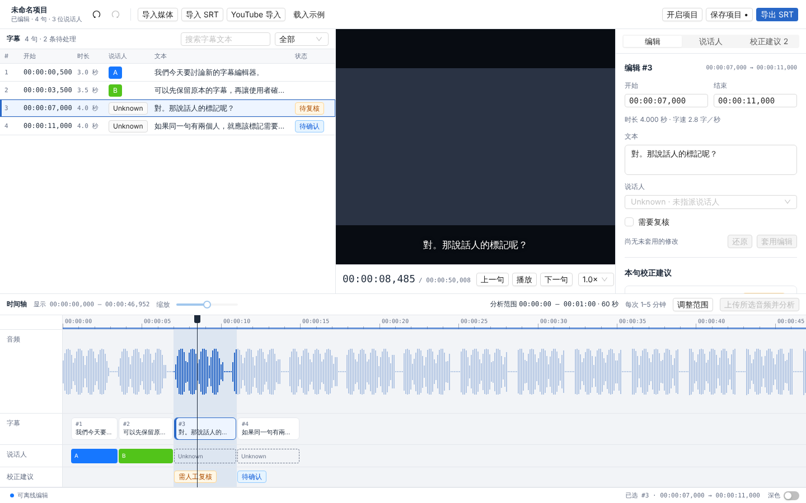

# Mousqueau v0.1

English | [简体中文](README_zh.md)

A Wails v3 desktop application for correcting **existing SRT subtitles** and reviewing speaker identities in conversations. Go + React/TypeScript + Vite + Ant Design v6, bootstrapped from the official Wails v3 React template and pinned to `v3.0.0-beta.28`. It runs on macOS, Windows, and Linux. macOS is the primary target and the only platform with hand-tested GUI behaviour; the Linux desktop build is exercised automatically under Xvfb, and Windows is compiled and unit-tested in CI only.



## Develop on macOS

Requirements: Go **1.25+**, Node **24 LTS**, pnpm **12.10.1** (pinned in `frontend/package.json`), Xcode Command Line Tools, and optionally FFmpeg / yt-dlp. No API key is required for editing.

If Vite+ manages your environment, it reads the pnpm pin in `frontend/package.json`; run `vp install --frozen-lockfile` from `frontend`. A global Vite+ installation is optional: the Wails tasks and CI invoke pnpm directly. To install the pinned pnpm with Node/npm, run `npm install --global pnpm@12.10.1`.

```sh
xcode-select --install
brew install go node ffmpeg
# Optional: downloads from video pages (install independently of Mousqueau)
brew install yt-dlp

go install github.com/wailsapp/wails/v3/cmd/wails3@v3.0.0-beta.28
# Ensure $(go env GOPATH)/bin is on PATH.
cd frontend
pnpm install --frozen-lockfile
cd ..
wails3 dev
```

For AI analysis, choose a provider under **Settings › Providers** (⌘, or Ctrl+,). Every provider diarizes the uploaded range unless noted:

| Provider | Model (default first) | Credential | Environment variable |
| --- | --- | --- | --- |
| OpenAI | `gpt-4o-transcribe-diarize` | API key | `OPENAI_API_KEY` |
| Deepgram | `nova-2`, `nova-3` | API key | `DEEPGRAM_API_KEY` |
| AssemblyAI | service default, `universal-3-5-pro`, `universal-2` | API key | `ASSEMBLYAI_API_KEY` |
| ElevenLabs | `scribe_v2` | API key | `ELEVENLABS_API_KEY` |
| Alibaba Cloud Model Studio | `paraformer-v2`, `fun-asr` | DashScope API key | `DASHSCOPE_API_KEY` |
| Tencent Cloud ASR | engine `16k_zh`, `16k_zh_video` | SecretId + SecretKey | `TENCENTCLOUD_SECRET_ID`, `TENCENTCLOUD_SECRET_KEY` |
| Custom (OpenAI-compatible) | any; speakers only with a model that returns `diarized_json` | optional API key | none |

Alibaba Cloud's file transcription reads audio from a URL, so Mousqueau first uploads the range to DashScope's own temporary storage, which expires on its own. AssemblyAI transcripts are deleted from the service after they are read. Tencent requests are signed (TC3-HMAC-SHA256), so the SecretKey is never sent. A custom service needs an HTTPS base URL such as `https://api.example.com/v1`, or plain HTTP on this computer. Adding a provider under mainland Chinese law, or a custom endpoint, first shows a warning about uploading audio on sensitive topics, and the upload confirmation repeats it.

Credentials are stored in the system credential store (macOS keychain, Windows Credential Manager, or the Secret Service keyring on Linux through `secret-tool`), one item per provider; the OpenAI item keeps its earlier name. Alternatively set the provider's environment variables in the environment of the **Go application** before launching; they win when all of them are set. A credential is typed once into the settings or welcome window and handed to Go; it is never written to project or settings files and never returned to the frontend. The application does not read `.env` files. Launching a packaged app through Finder, the Start menu, or a desktop launcher generally does not inherit terminal exports, so use the credential store there. On Linux, saving a key needs `secret-tool` (Debian/Ubuntu package `libsecret-tools`) and a running keyring such as GNOME Keyring or KWallet; without them, use the environment variable.

```sh
export OPENAI_API_KEY='your-key'
wails3 dev
```

FFmpeg and yt-dlp are looked up on that process's `PATH`, then (outside Windows) in `/opt/homebrew/bin` and `/usr/local/bin`; **Settings › External Tools** can pin either to another location. The first launch opens a short welcome window (theme, external tools, optional OpenAI key) that can be run again from Settings. Preferences are kept in `settings.json` under the user configuration directory (`~/Library/Application Support/Mousqueau` on macOS, `%AppData%\Mousqueau` on Windows, `~/.config/Mousqueau` on Linux). Update checks only read this repository's GitHub release list, at most once a day when automatic checking is on, and never download anything. Hover the environment indicator at the left of the status bar for dependency/configuration availability. The interface is in Simplified Chinese (简体中文), Taiwan Traditional (台湾正体, `zh-TW`), Hong Kong Traditional (香港繁体, `zh-HK`), Japanese (日本語, `ja-JP`) or US English. By default it follows the system's preferred languages (on macOS, a language set for Mousqueau under System Settings › General › Language & Region › Applications comes first): Hong Kong Chinese selects 香港繁体, which uses the Taiwan wording except where a Hong Kong entry overrides it; other Traditional Chinese, or Chinese for Taiwan or Macau, selects 台湾正体; any other Chinese uses Simplified; Japanese selects 日本語; anything else uses English. **Settings › General › Language** fixes it instead. Window titles, file dialogs, progress and error messages, and on macOS the menu bar, switch with it. A change of the system language applies on the next launch. **Settings › General › Subtitle font** sets the font family subtitle text is shown in (cue list, viewer overlay, timeline, text field and suggestions); a family that is not installed falls back to the interface font, and exported SRT is unaffected. See [Develop on Windows or Linux](#develop-on-windows-or-linux) for the other platforms. The server build described below is only for local testing, not a deployed service.

## Develop on Windows or Linux

The same Go, Node and pnpm versions apply, plus `wails3` as above. See the [Wails setup guide](https://v3.wails.io/getting-started/installation/) for the native toolchain.

- **Windows**: the WebView2 runtime (preinstalled on Windows 10/11). FFmpeg and yt-dlp can be installed with `winget install Gyan.FFmpeg` and `winget install yt-dlp.yt-dlp`.
- **Linux**: GTK4 and WebKitGTK 6 development packages, plus GStreamer plugins for media playback. On Ubuntu 24.04: `sudo apt install libgtk-4-dev libwebkitgtk-6.0-dev gstreamer1.0-plugins-good gstreamer1.0-libav ffmpeg libsecret-tools`. Install yt-dlp from its own releases or `pipx install yt-dlp`, since distribution packages lag behind YouTube changes. WebKitGTK runs its web content in a bubblewrap sandbox; where the system forbids unprivileged user namespaces (as GitHub's Ubuntu 24.04 runners do through AppArmor), the app exits at launch with `bwrap: setting up uid map: Permission denied` in its output.

On both, the windows have no native frame: the toolbar is the title bar (drag it to move the window, double-click to maximise) and the minimise, maximise and close buttons sit at its right, where macOS keeps its traffic lights on the left. Frameless windows resize from their edges. The three-line button to the left of the project title opens the application menu, including Settings (also Ctrl+,) and the user dictionary. Scrollbars in every window and popup follow the light or dark application theme.

### Build a Windows test executable from WSL

Install Go 1.25+ and the pinned pnpm in WSL, then run from the repository root:

```sh
CGO_ENABLED=0 go install github.com/wailsapp/wails/v3/cmd/wails3@v3.0.0-beta.28
export PATH="$(go env GOPATH)/bin:$PATH"
wails3 build GOOS=windows ARCH=amd64 CGO_ENABLED=0
wslpath -w "$PWD/bin/mousqueau.exe"
```

This uses Go cross-compilation; Docker and Linux GTK/WebKit development packages are unnecessary for the Windows target. Use `ARCH=arm64` for Windows on ARM. The build embeds the frontend and generates the Windows icon and DPI manifest. It produces a test executable, not an installer.

Open the path printed by `wslpath` in Windows Explorer. Windows needs the WebView2 runtime; FFmpeg and yt-dlp must also be Windows executables, configured in Settings or available on the Windows process's `PATH`. WSL's Linux tools do not supply those dependencies. Start with **Load Demo** without an API key, then check window controls, native SRT import/export, undo/redo, project save/reopen, and local media playback. See the [outstanding Windows acceptance checklist](docs/verification.md#windows-and-linux-acceptance-checklist-still-outstanding). A successful WSL build does not verify Windows GUI behavior.

## Use the editor

1. **Import** (the toolbar icon) › **Local Files** › **Media File**: select a local video or audio file. MP4/H.264/AAC is the most portable playback format. Native WebView codecs determine whether other formats play.
2. **Import** › **Local Files** › **SRT Subtitles**: select UTF-8 SRT subtitles. Identifiers, millisecond timestamps, and multiline text are preserved in the project. The window follows a video-editor layout: cue list (with text search and a To do / Unknown filter), viewer with the current subtitle overlaid, inspector, and a timeline with the audio waveform, subtitle blocks, speaker and suggestion tracks. Click a cue row or block to pause and seek; click the ruler or waveform to move the playhead. Playback follows the current cue when there are no pending field edits. Drag the dividers between the three columns and above the timeline to resize them; double-click one to restore its default size. The timeline shrinks with its tracks scrolling but does not grow past its content. The waveform is decoded locally by FFmpeg and needs FFmpeg on `PATH`; nothing is uploaded for it.
3. Click the subtitle in the viewer to edit its text; this pauses playback and opens the inspector's **Edit** tab, where start/end (`HH:MM:SS,mmm`) and speaker annotations are edited. Click **Apply Edit** to apply. The same tab holds the dictionary hits for the cue and its dictionary actions. Add A/B/C or other speaker identities in the **Speakers** tab. An unassigned cue shows **Unknown**. One cue can have multiple speakers. Undo/redo (toolbar, ⌘Z / ⇧⌘Z, or Ctrl+Z / Ctrl+Shift+Z outside text fields) covers edits, speaker names, analysis results, and accept/reject decisions; the last 100 undo snapshots are retained.
4. Optionally select **60–300 seconds** by dragging on the timeline ruler or with **Adjust Range**, and explicitly confirm **Upload & Analyze**. Go extracts mono AAC using FFmpeg, limits uploads to 24 MB, and sends it to the provider chosen in Settings with `language=zh` (OpenAI: `gpt-4o-transcribe-diarize` with `diarized_json` and `chunking_strategy=auto`). Speaker numbers are shown as letters. API calls and subprocesses can be cancelled. Cancellation discards pending results; it cannot recall bytes already sent or cancel provider billing.
5. Compare original text with transcription suggestions and highlighted changes in the **Fixes** tab, or for the selected cue under **Edit**. Accept or reject individually. Review flags identify multiple speakers, overlap, and segments crossing a cue/range boundary. Suggestions **never silently modify text or speakers**. Accepting a stale suggestion after a manual text change is refused; analyze again or edit manually.
6. **Save Project** writes JSON with immutable original cues, editable cues, speaker mappings, transcription segments, suggestions, and undo/redo history. **Open Project** restores it. The local media path is saved; if the file moved, reimport it. Projects contain transcripts and local paths, but not API keys.
7. **Export SRT** writes the edited text/times without speaker metadata. Both saves and exports require a **new filename**: existing destinations are refused, including hardlinks/symlinks to source files. Originals are never overwritten. Keep a JSON project to retain speaker information and history.

Use **Load Demo** for a Traditional Chinese conversation and mock diarization without an API key. The third cue deliberately includes overlapping speakers. The UI follows the system appearance by default and can be fixed to light or dark in Settings. Existing UTF-8 Traditional Chinese text is preserved. Taiwan Mandarin audio is processed with Chinese-language transcription; OpenAI can still return Simplified Chinese or misrecognize names. Verify wording and script before accepting. The diarization model does not support a transcription prompt, so v0.1 does not invent a prompt-based Traditional Chinese guarantee or apply stylistic rewriting.

## Optional download from the web

Open **Import** › **Download from the Web** and paste an HTTPS link to one video page. Any site your yt-dlp supports works, YouTube included; YouTube links are reduced to the single video. **Find** shows the title, site and length, and lists manual subtitle tracks before automatic captions. Choose what to import, then press **Import** once:

- **Subtitles**: the selected track, converted to SRT by `yt-dlp` and FFmpeg. It replaces the active subtitle project after confirmation.
- **Media**: **None**, **Audio Only** (`.m4a`) or **Video** (`.mp4`, H.264/AAC where the site offers it, at most 1080p, so it plays in every platform's web view). Media needs the "I am authorized" box. You choose a new file name; existing files are never replaced, and the download becomes the local media source.

The dialog shows the current step with a percentage and a **Cancel** button. Downloading never uploads anything. Playlists, channels and batch downloads are excluded. Availability depends on yt-dlp, the network and the video; logins and cookies are outside v0.1. Full YouTube support in current yt-dlp releases may also require its documented JavaScript runtime/EJS dependencies. Local file imports do not need yt-dlp.

## Tests and builds

```sh
go test ./internal/...
cd frontend
pnpm install --frozen-lockfile
pnpm run typecheck
pnpm test
pnpm run build
cd ..
node --test scripts/frontend-dependencies.test.mjs
# Native desktop build / package for the current platform
wails3 build
wails3 package
```

Wails defaults to pnpm for dependency installation and frontend scripts. Commit `frontend/pnpm-lock.yaml` with dependency changes; routine builds use the frozen lockfile. This migration retains the existing dependency versions and Vite/Vitest configuration.

Bindings are checked in and generated from Go service signatures. Regenerate after changing a service method:

```sh
wails3 generate bindings -ts -i
```

To drive the native Linux build without a desktop (for example in CI or a cloud container), install `xvfb openbox xdotool x11-utils imagemagick` as well, build the frontend and then:

```sh
go build -tags production -o /tmp/mousqueau .
xvfb-run -a -s "-screen 0 1700x1050x24" dbus-run-session -- scripts/linux-gui-smoke.sh /tmp/mousqueau /tmp/mousqueau-shots
```

It opens the welcome window with a fresh configuration, closes it with the drawn close button, maximises and restores the editor with its button and by double-clicking the title bar, opens settings with Ctrl+,, closes it and quits by closing the editor, saving a screenshot of each state. It checks GTK/WebKitGTK behaviour only, not macOS or Windows.

On macOS (Xcode command-line tools provide `swiftc`), build the frontend and then:

```sh
go build -tags production -o /tmp/mousqueau .
scripts/macos-launch-smoke.sh /tmp/mousqueau /tmp/mousqueau-shots
```

It launches the app with a fresh configuration three times in light and three times in dark system appearance, and fails if it exits, logs a panic, or shows no window within 30 seconds. Each launch stays open past the ten-second window-reveal fallback before it is stopped. It switches the system appearance while running and restores it afterwards. The screenshots are for a person to look at: the script does not check colours, so a white first frame still needs checking by eye on a Mac.

For headless Linux verification without GTK/WebKit, build the frontend first, then:

```sh
CGO_ENABLED=0 wails3 generate bindings -ts -i -f '-tags=server'
CGO_ENABLED=0 go test -tags server ./...
CGO_ENABLED=0 go build -tags server -o /tmp/mousqueau-headless .
WAILS_SERVER_HOST=127.0.0.1 WAILS_SERVER_PORT=9246 /tmp/mousqueau-headless
```

The headless build uses real Wails bindings and allows a browser to exercise the editor/demo; native file dialogs are unsupported there. Keep it on loopback: this is a desktop application, not a remotely hosted authenticated service. Never claim this verifies macOS GUI behavior. CI checks core/frontend/server, builds native macOS and Windows binaries and runs the Go tests on both, and builds the native Linux desktop app and runs the GUI smoke test above; automated builds do not replace GUI testing on a real Mac or Windows PC.

See [verification and Mac checklist](docs/verification.md), [architecture](docs/architecture.md), and [limitations / v0.2](docs/limitations.md).

## License

Original Mousqueau code: **MIT**. yt-dlp and FFmpeg are separate, user-installed CLI dependencies and are not bundled. yt-dlp source is Unlicense, but some executable distributions contain GPLv3+ code. See the [licensing decision](docs/licensing.md) and `THIRD_PARTY_NOTICES.txt`; include the notices in distributions. Regenerate with `node scripts/notices.mjs` after installing dependencies.
